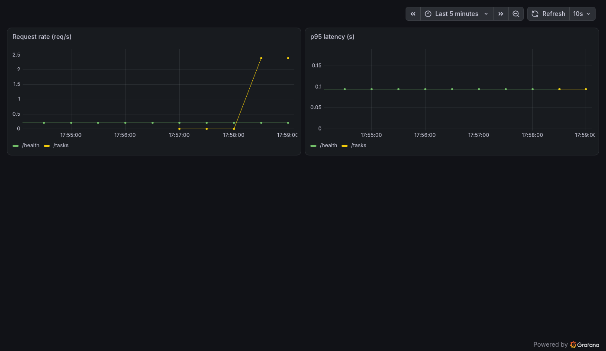

# tasks-api-k8s-infra


A deliberately simple CRUD API + Postgres, deployed entirely via Terraform
onto a local Kubernetes cluster (`kind`) — with Helm packaging, ingress,
autoscaling, and a Prometheus/Grafana monitoring stack. The app itself is
unglamorous on purpose: Terraform and Kubernetes operations are the actual
subject of this project.

Built as a portfolio project, one milestone at a time — one GitHub issue,
branch, and PR per milestone. See [merged PRs](../../pulls?q=is%3Apr+is%3Amerged)
for how it came together.

## Architecture

```
Terraform
  ├─ kind provider       → creates the local Kubernetes cluster
  ├─ kubernetes provider → namespace
  └─ helm provider       → tasks-api chart, ingress-nginx, metrics-server,
                            kube-prometheus-stack

Inside the cluster:
  tasks-api (FastAPI + SQLAlchemy)  ──►  Postgres (PVC)
       │  /metrics                         ▲
       ▼                                   │
  Prometheus ──► Grafana               HorizontalPodAutoscaler
       (ServiceMonitor scrape)         (scales tasks-api on CPU load)

  Ingress (ingress-nginx) routes external traffic to tasks-api
```

## Status

- [x] M1 — Cluster via Terraform
- [x] M2 — App + database on Kubernetes
- [x] M3 — Helm chart
- [x] M4 — Ingress + autoscaling
- [x] M5 — Observability on Kubernetes
- [x] M6 — Polish

See the [issues](../../issues?q=is%3Aissue) and merged PRs for how each
milestone was built and verified.

## What this demonstrates

This project exists to practice Terraform and Kubernetes specifically —
the CRUD app is intentionally the least interesting part of it. What's
actually being exercised:

- **Terraform as the single entry point**, across three different kinds of
  providers in one state: a cluster-lifecycle provider (`kind`), a direct
  resource provider (`kubernetes`), and a package-manager provider (`helm`)
  — including the ordering problems that come from mixing them (see
  `terraform/cluster.tf` and `terraform/app_image.tf`: building and
  `kind load`-ing a local Docker image isn't a resource any provider
  exposes, so it's done via `terraform_data` + `local-exec`).
- **Helm as the deployment unit**, not just raw manifests — `charts/tasks-api`
  is a real chart with conditionals (autoscaling on/off changes what the
  Deployment template emits), not a templated copy-paste of M2's raw YAML.
- **Autoscaling that's actually been watched scale**, not just declared —
  M4's verification generated real CPU load through the ingress and
  confirmed the HPA added and later removed replicas, including
  understanding its default 5-minute rolling scale-down window.
- **Observability wired to a real signal**, not a dashboard with no data
  behind it — Prometheus Operator's `ServiceMonitor` CRD scraping the
  app's own `/metrics`, and a Grafana dashboard auto-provisioned via the
  sidecar ConfigMap convention rather than clicked together by hand:

  

  (`/tasks` jumping to ~2.5 req/s is a load burst generated with `make load`
  while this was captured — not synthetic data.)

## Design decisions

- **Local `kind` cluster, not a real cloud cluster.** The Terraform and
  Kubernetes concepts are identical either way, and this avoids cloud
  cost/cleanup discipline becoming the thing this project is actually
  about.
- **A deliberately boring app.** Postgres + a FastAPI CRUD API, nothing
  more — so that every design decision in the repo is about infra, not
  about application architecture.
- **`terraform_data` + `local-exec` for the Docker build/load step**,
  instead of reaching for a dedicated provider resource — `tehcyx/kind`
  (the Terraform provider used here) only exposes a `kind_cluster`
  resource, not a `kind_load` one, so the real `docker build` /
  `kind load docker-image` CLI calls are shelled out to directly.
- **Several `kube-prometheus-stack` sub-features disabled on purpose**
  (`prometheusOperator.admissionWebhooks`, `prometheusOperator.tls`) —
  they guard `PrometheusRule` validation, which this project doesn't use,
  and their cert-generation Jobs proved flaky on a single-node `kind`
  cluster (see `terraform/observability.tf`). Turning off an unused
  feature was preferred over fighting a hook's retry/timeout behavior.
- **One Terraform state, no remote backend.** At this scale, for a
  learning project that lives on one machine, a remote backend would add
  ceremony without adding anything demonstrated.

## Running it

**Prerequisites:** Docker, Terraform, `kind`, `kubectl`, `helm` — see
[docs/prerequisites.md](docs/prerequisites.md) (all installed as plain
user-local binaries, no system package manager or `sudo` needed).

```
make up      # terraform init + apply — brings up the whole stack
make status  # kubectl get nodes / pods -A
make urls    # how to reach tasks-api, Grafana, Prometheus
make load    # generate traffic against tasks-api (e.g. to watch the HPA)
make down    # terraform destroy
```

Equivalent to `make up`/`make down` directly, if you'd rather not use the
Makefile:

```
cd terraform
terraform init
terraform apply   # or: terraform destroy
```

## License

MIT
